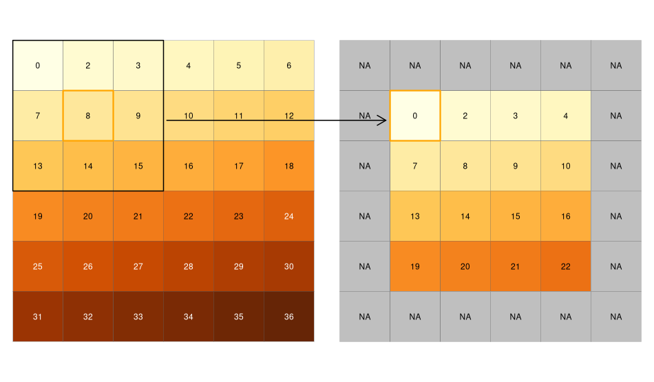

```{r}
#| echo: false
#| output: false
set.seed(55)
if (.Platform$OS.type == "windows" && Sys.getenv("PROJ_LIB") != ""){
  Sys.setenv(PROJ_LIB = "")
}
library(terra)
landscape <- rast("data/landcover_4.tif")
df_levels <- data.frame(id = 1:4, cover = c("settlement", "agriculture", "forest", "unproductive"))
levels(landscape) <- df_levels
```

# Raster analysis

::: {.callout-tip appearance="minimal" collapse="true" title="If you start from here..."}
Run the following code to load and create everything you'll need to run the examples in this section.
```{r}
#| eval: false
library(terra)
landscape <- rast("data/landcover_4.tif")
df_levels <- data.frame(id = 1:4, cover = c("settlement", "agriculture", "forest", "unproductive"))
levels(landscape) <- df_levels
```
:::

## Basic raster properties

Using standard functions available in `terra`, we can easily get general information about our raster, such as the number of cells, the dimension, the extent or the spatial resolution.

```{r}
ncell(landscape)
dim(landscape)
ext(landscape)
c(xmin(landscape), xmax(landscape), ymin(landscape), ymax(landscape))
res(landscape)
```


## Summarizing rasters

For discrete rasters, you can easily get the frequency distribution of all the available categories.

```{r}
freq(landscape)
barplot(landscape)
```


## Raster binarization

```{r}
landscape_layers <- segregate(landscape)
names(landscape_layers) <- c("settlement", "agriculture", "forest", "unproductive")
plot(landscape_layers)
```


## Computing landcover proportions

```{r}
landscape_agg <- aggregate(landscape_layers, 10, fun = function(i) {sum(i) / 100})
plot(landscape_agg)
```

Until now we saw examples of global, zonal and local analyses with raster data. Now we're going to dive in the beautiful world of focal analyses. Note that people doing data science and mathematics will usually use the word convolution instead. Focal means that we're not only considering the pixel value, but also the values of the neighboring pixels. The neighborhood is called kernel or moving window and is usually a square (like a 3x3 square, the focal pixel and its 8 neighbors) or a circle. Once the neighborhood is defined, we perform an aggregation of the pixel values (e.g. by summing or averaging) within the neighborhood and store the output as the new value for the focal cell, and then we move the window to the next pixel. The following figure shows a example using a 3x3 moving window and the minimum as the aggregating function.



Note that the output raster will usually be smaller than the original one (if the moving window is a $m$x$n$ matrix, the output will have $(m-1)$ less rows and $(n-1)$ less columns). If you want a raster with the same size as the original, you'll need to ignore the NA values, hence the window will be smaller in the margins of the raster.`

Focal analyses are really interesting to characterize the habitat of a site since you also get information about the neighboring areas. Using a discrete raster we can for example compute the number of pixels for each landcover classes in the neighborhood of each pixel. Note that the size of the moving window has to be an odd number.

```{r}
landscape_focal <- focal(landscape_layers, 5, fun = "sum")
plot(landscape_focal)
```
