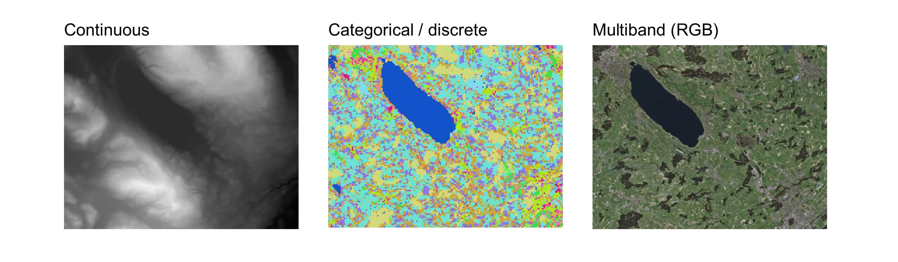

```{r}
#| echo: false
#| output: false
set.seed(55)
if (.Platform$OS.type == "windows" && Sys.getenv("PROJ_LIB") != ""){
  Sys.setenv(PROJ_LIB = "")
}
library(terra)
```

# Raster data

## Raster data model

A raster data set is basically an image, which is the same as a grid of pixels. These pixels are often called cells. Most raster data sets you will encounter will have square (or maybe rectangular) cells with a constant size, also called resolution, and we will only focus on these in this tutorial. However don't forget that other kind of grids, for example sheared or curvilinear ones, also exist. This is sometimes needed depending on the coordinate reference system used to store the data, or can be caused by some reprojections.

For this tutorial, we will focus on rasters containing discrete values. The content of each cell describes the dominant category of land use or land cover. However, rasters are also commonly used to store continuous values. Digital elevation models are a typical example of such data, each cell is used to store an elevation value. Continuous rasters can also be used to characterize landscapes and habitats, for example by storing the percentage of forest cover in each cell.

Raster data sets can sometimes have several bands. You can think of raster bands as different layers of the same grid, each layer containing a different information. This is mainly use for spectral data, for example the red, green and blue intensity values in an aerial picture; satellite imagery will have even more bands depending on the number of sensors. Multiband rasters are also often used to store environment variables that change through time (e.g. a temperature raster, with one band per day). Such rasters are often called datacubes.




## Raster data in R